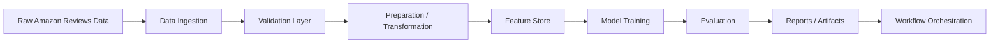

# Architecture Diagram

The recommended system pipeline is structured in stages: ingestion, validation, cleansing, feature engineering, model training, evaluation, and orchestration. Each stage produces artifacts and is tested for reproducibility.
